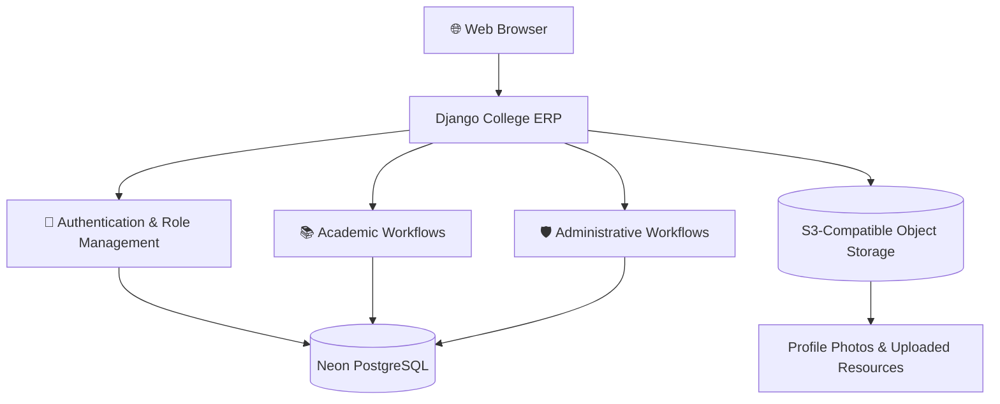

<!-- ========================================================= -->
<!--           VELOCITY TECH UNIVERSITY README                -->
<!-- ========================================================= -->

<div align="center">


<p>
  <b>A Centralized Platform for Smarter Academic Management</b>
</p>

<p>
  Managing students, faculty, academic records, and administrative workflows through one integrated platform.
</p>

<p>
  
  
  
  
</p>

<p>
  <a href="https://github.com/Rohitnag2004/College-ERP-System">
    
  </a>
</p>

</div>

---

## 📑 Table of Contents

- [Overview](#-overview)
- [Key Features](#-key-features)
- [Technology Stack](#-technology-stack)
- [System Architecture](#-system-architecture)
- [Getting Started](#-getting-started)
- [Environment Configuration](#-environment-configuration)
- [Deployment](#-deployment)
- [Security](#-security)
- [Project Documentation](#-project-documentation)
- [Contributing](#-contributing)
- [License](#-license)

---

## 🌐 Overview

**Velocity Tech University** is a Django-based College Enterprise Resource Planning (ERP) system built to organize academic and administrative operations in one centralized application.

The platform supports three primary roles:

- 🛡️ **Administrator** — manages users, teacher approvals, academic operations, and system controls.
- 👨‍🏫 **Teacher** — accesses teacher-oriented academic and classroom workflows.
- 🎓 **Student** — accesses student services and academic information.

The application uses **Neon PostgreSQL** for application records and **S3-compatible object storage** for production uploads such as profile photos and learning resources.

### 🎯 Project Goals

- Simplify routine academic administration.
- Centralize student and faculty workflows.
- Organize academic records and learning resources.
- Support cloud-based database and file storage.
- Provide a responsive and accessible web interface.

---

## ✨ Key Features

<table>
<tr>
<td width="50%" valign="top">

### 🔐 Authentication
- Role-aware sign-in
- Student registration
- Teacher registration
- Administrative teacher approval

</td>
<td width="50%" valign="top">

### 🛡️ Administration
- User management
- Academic administration
- Assignment management
- Independent student and teacher maintenance controls

</td>
</tr>
<tr>
<td width="50%" valign="top">

### 📚 Academic Management
- Course applications
- Attendance records
- Examination results
- Assignments and notices

</td>
<td width="50%" valign="top">

### 💳 Institutional Workflows
- Fee records and demo fee workflows
- Teacher salary demonstration workflows
- Learning resources
- Academic information management

</td>
</tr>
<tr>
<td width="50%" valign="top">

### 🖥️ User Experience
- Responsive dashboards
- Search and pagination
- Role-specific interfaces
- Five-minute idle session expiry

</td>
<td width="50%" valign="top">

### ☁️ Cloud Infrastructure
- Neon PostgreSQL
- S3-compatible object storage
- WhiteNoise static file serving
- Gunicorn production server

</td>
</tr>
</table>

> **Disclaimer:** Fee and teacher salary workflows are demonstrational. The application does not transfer money.

---

## 🧰 Technology Stack

<div align="center">

| Technology | Purpose |
|:---|:---|
| 🐍 Python | Core programming language |
| 🎯 Django | Web framework and application logic |
| 🐘 PostgreSQL | Relational database |
| ☁️ Neon | Hosted PostgreSQL and object storage |
| 📦 S3-compatible storage | Uploaded media and learning resources |
| 🚀 Gunicorn | Production WSGI server |
| 🧱 WhiteNoise | Static asset serving |
| 🔧 Git & GitHub | Version control and source code hosting |

</div>

---

## 🏗️ System Architecture



### ☁️ Storage Design

| Component | Responsibility |
|:---|:---|
| Django | Application logic, authentication, and workflows |
| Neon PostgreSQL | Application records and relational data |
| Object storage | Production media uploads |
| WhiteNoise | Static assets collected during deployment |
| Gunicorn | Serves the Django application in production |

**Important:** Production uploads are stored in remote object storage, not on a user's computer or the web host's temporary local filesystem.

---

## 🚀 Getting Started

Follow the steps below to run the project on your local computer.

### 📋 Prerequisites

Before you begin, make sure you have:

- Python 3.10 or later
- Git installed
- Access to a PostgreSQL database
- The required environment variables
- An S3-compatible bucket if remote media uploads are needed

### 1️⃣ Clone the Repository

```bash
git clone https://github.com/Rohitnag2004/College-ERP-System.git
cd College-ERP-System
```

### 2️⃣ Create a Virtual Environment

**Windows PowerShell**

```powershell
python -m venv .venv
.\.venv\Scripts\Activate.ps1
```

### 3️⃣ Install Dependencies

```bash
python -m pip install --upgrade pip
python -m pip install -r requirements.txt
```

### 4️⃣ Create Your Environment File

```powershell
Copy-Item .env.example .env
```

Open `.env` and configure the values for your development environment.

### 5️⃣ Apply Database Migrations

```bash
python manage.py migrate
```

### 6️⃣ Start the Development Server

```bash
python manage.py runserver
```

Open the application:

**http://127.0.0.1:8000/**

> The repository does not include default account passwords or production secrets. Configure accounts using the application's supported registration and administrative workflows.

---

## ⚙️ Environment Configuration

The following variables are used by the application. Set only the variables required for your chosen configuration.

| Variable | Description |
|:---|:---|
| `DJANGO_SECRET_KEY` | Django secret key |
| `DJANGO_DEBUG` | Debug mode setting |
| `DJANGO_ALLOWED_HOSTS` | Allowed hostnames |
| `DATABASE_URL` | PostgreSQL connection URL |
| `CSRF_TRUSTED_ORIGINS` | Trusted application origins |
| `USE_REMOTE_MEDIA` | Enables remote media storage |
| `AWS_STORAGE_BUCKET_NAME` | Object-storage bucket |
| `AWS_ACCESS_KEY_ID` | Object-storage access key |
| `AWS_SECRET_ACCESS_KEY` | Object-storage secret key |
| `AWS_ENDPOINT_URL_S3` | Optional S3-compatible endpoint |
| `AWS_REGION` | Object-storage region |
| `EMAIL_HOST` | SMTP server hostname |
| `EMAIL_PORT` | SMTP server port |
| `EMAIL_HOST_USER` | SMTP account username |
| `EMAIL_HOST_PASSWORD` | SMTP credential or app password |
| `EMAIL_USE_TLS` | Enables SMTP TLS |
| `DEFAULT_FROM_EMAIL` | Default sender address |

### 🔒 Configuration Rules

- Use a fresh secret key for your own installation.
- Set `DJANGO_DEBUG=true` only for local development.
- Use a valid database connection URL.
- Configure remote storage credentials when `USE_REMOTE_MEDIA=true`.
- Keep `.env` out of version control.
- Never publish database passwords, secret keys, or storage credentials.

The `.env.example` file should contain placeholders, never real credentials.

---

## ☁️ Deployment

The application is designed for deployment on a Django-compatible hosting service, with Neon PostgreSQL and private S3-compatible object storage.

### Production Checklist

- [ ] Configure `DJANGO_SECRET_KEY`.
- [ ] Set `DJANGO_DEBUG=false`.
- [ ] Set `DJANGO_ALLOWED_HOSTS` to the deployed hostname.
- [ ] Configure `CSRF_TRUSTED_ORIGINS` for the HTTPS domain.
- [ ] Set the production `DATABASE_URL`.
- [ ] Configure the required remote object-storage credentials.
- [ ] Configure SMTP if password-reset email is required.
- [ ] Run database migrations.
- [ ] Collect static files.
- [ ] Test authentication, dashboards, database access, and file uploads.

### Deployment Commands

```bash
python manage.py migrate
python manage.py collectstatic --noinput
```

The repository's `Procfile` defines the Gunicorn startup command. Use the repository's actual build and start configuration in the hosting dashboard.

> **Before production:** This project's settings require remote media storage when debug mode is disabled. Configure the private storage bucket and required credentials before deploying.

For detailed deployment, cloud storage, migration, and maintenance instructions, read the **[Developer Guide](DEVELOPER_GUIDE.md)**.

---

## 🔐 Security

Security is essential for an application that manages academic records.

- Never commit `.env` files or production credentials.
- Use HTTPS and secure production settings.
- Keep uploaded files in private object storage.
- Avoid publishing student records, personal information, or passwords in screenshots.
- Review changes before deploying them to production.
- Give database credentials only to trusted environments.

For security-related disclosures, consult `SECURITY.md` if the repository provides one.

---

## 📂 Project Documentation

| Resource | Description |
|:---|:---|
| [README](README.md) | Project overview and setup guide |
| [Developer Guide](DEVELOPER_GUIDE.md) | Architecture, deployment, storage, and maintenance |
| [Project Report](docs/College-ERP-Project-Report-Redacted.pdf) | Project report |
| [License](LICENSE) | Applicable license terms |

---

## 🖼️ Application Screenshots

Screenshots of the actual application can be added here to showcase the interface.

Recommended screenshots:

- Administrator Dashboard
- Student Dashboard
- Teacher Dashboard
- Course and Attendance Management
- Results and Fee Management

Store verified screenshots in `docs/screenshots/` and embed them using relative paths, for example:

```markdown

```

Only add screenshots that exist in the repository.

---

## 🛣️ Future Improvements

Potential areas for future development include:

- Automated email notifications and password recovery
- Expanded academic analytics and reports
- Additional automated tests
- Continuous integration and deployment
- More comprehensive user and deployment documentation

These are possible enhancements, not claims that the features are already implemented.

---

## 🤝 Contributing

Suggestions, bug reports, and improvements are welcome.

1. Fork this repository.
2. Create a feature branch.
3. Make your changes.
4. Test the changes locally.
5. Submit a pull request with a clear description.

Please review the repository's contribution guidelines before submitting changes.

---

## 📄 License

This project is distributed under the terms described in the [LICENSE](LICENSE) file.

---

<div align="center">

### 💙 Built for Smarter Academic Management

**Velocity Tech University — College ERP System**

<a href="https://github.com/Rohitnag2004/College-ERP-System">
  
</a>

<p><sub>Powered by Python · Django · PostgreSQL</sub></p>

</div>
