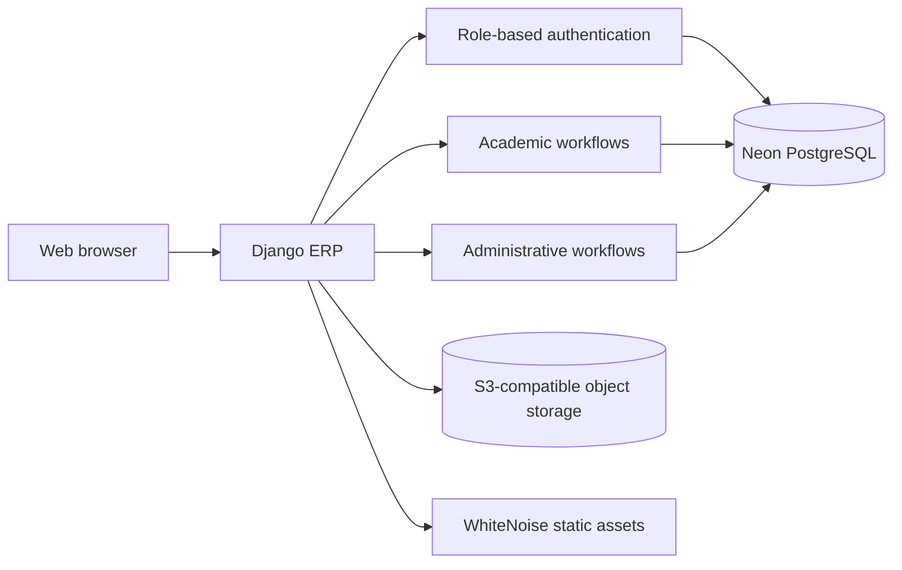

<div align="center">

# Velocity Tech University

### College ERP & Academic Management System

An online portal for students, teachers, and administrators to manage everyday academic activities in one place.

[](https://velocity-tech-university.onrender.com)
[](https://github.com/Rohitnag2004/College-ERP-System/actions/workflows/django.yml)
[](https://www.python.org/)
[](https://www.djangoproject.com/)
[](https://www.postgresql.org/)

[Open the live portal](https://velocity-tech-university.onrender.com) · [View the source code](https://github.com/Rohitnag2004/College-ERP-System)

</div>

---

## Contents

- [About](#about)
- [Live site and dashboards](#live-site-and-dashboards)
- [Screenshots](#screenshots)
- [Features](#features)
- [Architecture](#architecture)
- [Technology](#technology)
- [Run locally](#run-locally)
- [Environment configuration](#environment-configuration)
- [Deployment](#deployment)
- [Security and demo limitations](#security-and-demo-limitations)
- [Project documentation](#project-documentation)
- [Contributing](#contributing)
- [License](#license)

## About

Velocity Tech University College ERP is a Django web application for organizing academic and administrative work. It provides different dashboards and permissions for administrators, teachers, and students.

The live application is hosted on Render. PostgreSQL data is stored in Neon, and uploaded media uses S3-compatible object storage.

## Live site and dashboards

Sign in with an account for the matching role. These links open protected dashboards; they do not provide or create an account.

| Role | Dashboard |
|---|---|
| Administrator | [Open administrator dashboard](https://velocity-tech-university.onrender.com/admin/home/) |
| Teacher | [Open teacher dashboard](https://velocity-tech-university.onrender.com/staff/home/) |
| Student | [Open student dashboard](https://velocity-tech-university.onrender.com/student/home/) |

[Sign in](https://velocity-tech-university.onrender.com/) · [Student registration](https://velocity-tech-university.onrender.com/register/student/) · [Teacher registration](https://velocity-tech-university.onrender.com/register/teacher/)

Teacher accounts need administrator approval before signing in. Administrator accounts are created by an existing administrator.

## Screenshots

### Administrator dashboard


### Teacher dashboard


### Student dashboard


These images are interface previews from the repository's `Showcase` folder. They may show sample data.

## Features

- **Role-based accounts:** separate access for administrators, teachers, and students.
- **Academic administration:** manage students, staff, courses, subjects, sessions, and teacher assignments.
- **Attendance and results:** take and review attendance, manage results, and share grade cards.
- **Course registration:** students can request courses and administrators can review requests.
- **Learning resources and library:** share course materials and manage books.
- **Notices and communication:** publish notices, notifications, feedback, and leave requests.
- **Fees and salary records:** view and manage institutional records. Payment and salary flows are demonstration workflows and do not transfer money.
- **Cloud-ready uploads:** store profile photos and learning materials in S3-compatible object storage.

## Architecture



PostgreSQL stores application records. Private object storage holds uploaded media such as profile photos and learning resources. Static site assets are collected at build time and served by WhiteNoise.

## Technology

- Python 3.12+
- Django 5.2
- PostgreSQL with Neon
- Neon Object Storage or another S3-compatible storage provider
- Gunicorn and WhiteNoise
- GitHub Actions for automated checks

## Run locally

### Requirements

- Python 3.12 or later
- Git
- A PostgreSQL database
- An S3-compatible bucket for persistent uploaded files

### Setup

```bash
git clone https://github.com/Rohitnag2004/College-ERP-System.git
cd College-ERP-System
python -m venv .venv
```

Activate the environment and install packages:

```powershell
# Windows PowerShell
.\.venv\Scripts\Activate.ps1
python -m pip install -r requirements.txt
Copy-Item .env.example .env
```

On macOS or Linux, activate and copy the environment template with:

```bash
source .venv/bin/activate
python -m pip install -r requirements.txt
cp .env.example .env
```

Edit `.env` with your own development values. Never copy production credentials into the repository. For a local-only setup without remote uploads, use `DJANGO_DEBUG=true` and `USE_REMOTE_MEDIA=false`. Then run:

```bash
python manage.py migrate
python manage.py runserver
```

Visit [http://127.0.0.1:8000/](http://127.0.0.1:8000/). Create accounts through the supported registration flow; the repository does not include public demo passwords.

## Environment configuration

Copy `.env.example` to `.env` and replace the placeholders for your own local setup. Production values belong in the hosting provider's environment-variable settings, never in Git.

| Variable | Purpose |
|---|---|
| `DJANGO_SECRET_KEY` | Secret key used by Django |
| `DJANGO_DEBUG` | Turns debug mode on or off |
| `DJANGO_ALLOWED_HOSTS` | Comma-separated allowed hostnames |
| `DATABASE_URL` | PostgreSQL connection URL |
| `CSRF_TRUSTED_ORIGINS` | Trusted HTTPS origins in production |
| `USE_REMOTE_MEDIA` | Enables S3-compatible upload storage |
| `AWS_STORAGE_BUCKET_NAME` | Object-storage bucket name |
| `AWS_ACCESS_KEY_ID` / `AWS_SECRET_ACCESS_KEY` | Object-storage credentials |
| `AWS_ENDPOINT_URL_S3` | S3-compatible provider endpoint |
| `AWS_REGION` | Object-storage region |
| `AWS_S3_ADDRESSING_STYLE` | Use `path` for Neon Object Storage |
| `EMAIL_HOST`, `EMAIL_PORT`, `EMAIL_HOST_USER`, `EMAIL_HOST_PASSWORD` | SMTP settings for password-reset email delivery |
| `EMAIL_USE_TLS`, `DEFAULT_FROM_EMAIL` | SMTP security and sender address |

For disposable local development only, set `DJANGO_DEBUG=true` and `USE_REMOTE_MEDIA=false` to store uploads on your computer. Production requires a configured database and private remote media storage.

## Deployment

The production service uses environment variables for Django configuration, the Neon database, and object-storage credentials. Never commit `.env` or share secret values.

Typical Render commands:

```bash
pip install -r requirements.txt && python manage.py collectstatic --noinput && python manage.py migrate
```

```bash
gunicorn college_management_system.wsgi:application --bind 0.0.0.0:$PORT
```

See [DEVELOPER_GUIDE.md](DEVELOPER_GUIDE.md) for storage, environment, deployment, and maintenance details. Render Free services may spin down when idle, so the first request after inactivity can take longer to respond.

### Production checklist

- Set `DJANGO_DEBUG=false` and a new secret key.
- Set the deployed domain in `DJANGO_ALLOWED_HOSTS` and the HTTPS origin in `CSRF_TRUSTED_ORIGINS`.
- Configure the production PostgreSQL URL and private object-storage credentials.
- Run database migrations and collect static files.
- Smoke-test role sign-in, dashboard access, database connectivity, and file uploads.

## Security and demo limitations

- Do not commit `.env`, database URLs, secret keys, or object-storage credentials.
- Do not publish real student records, personal data, or account passwords in screenshots.
- Fee and teacher-salary workflows are demonstrations; they do not transfer money.
- Password-reset email delivery needs a configured email provider. It is not ready until the production email settings are configured.

## Project documentation

| Document | What it covers |
|---|---|
| [Developer Guide](DEVELOPER_GUIDE.md) | Deployment, cloud storage, and maintenance |
| [Project report](docs/College-ERP-Project-Report-Redacted.pdf) | Redacted project report |
| [Contributing guide](CONTRIBUTING.md) | How to contribute |
| [Security policy](SECURITY.md) | Security reporting guidance |
| [License](LICENSE) | Project license terms |

## Project files

| Path | Description |
|---|---|
| `college_management_system/` | Django project settings and URL configuration |
| `main_app/` | Application code, templates, and static assets |
| `Showcase/` | Dashboard preview images |
| `docs/` | Project report |
| `DEVELOPER_GUIDE.md` | Deployment and maintenance guide |

## Contributing

Bug reports and improvements are welcome. Please read [CONTRIBUTING.md](CONTRIBUTING.md), create a focused branch, and include a clear description of your change.

## License

See [LICENSE](LICENSE) for the terms that apply to this project.

---

<div align="center">

Built with Django for academic and college administration.

[Live website](https://velocity-tech-university.onrender.com) · [GitHub repository](https://github.com/Rohitnag2004/College-ERP-System)

</div>
